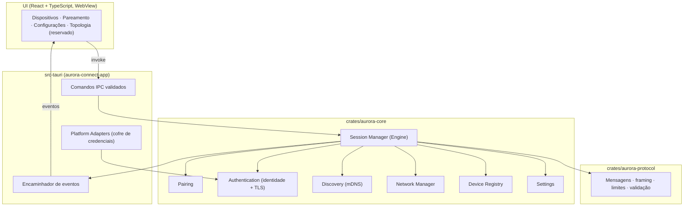

# Arquitetura — Aurora Connect

> Dois computadores. Um único controle.

Este documento registra a arquitetura do Aurora Connect e as decisões técnicas tomadas
no **Ciclo 01 — Fundação e conectividade**. Decisões futuras devem ser acrescentadas como
novos registros (ADR) ao final, sem reescrever o histórico.

## 1. Princípios

1. **Local-first e independente**: nenhum serviço externo, conta, internet ou IA é necessário.
   Toda comunicação acontece na rede local, entre dispositivos explicitamente pareados.
2. **Confiança explícita**: descobrir um dispositivo não significa confiar nele. Uma sessão só
   existe entre dispositivos que se autenticaram criptograficamente **e** foram aprovados pelo
   usuário nos dois lados.
3. **Núcleo testável e sem UI**: toda a lógica de rede, segurança e sessão vive em crates Rust
   independentes do Tauri, testáveis em processo e entre processos.
4. **Plataforma isolada em adaptadores**: tudo que depende do sistema operacional (cofre de
   credenciais, entrada, clipboard) fica atrás de traits. Windows é a primeira plataforma; Linux
   e macOS entram implementando os mesmos traits.
5. **Sem implementações fictícias**: componentes de ciclos futuros são apenas documentados.

## 2. Visão geral



### Estrutura do repositório

| Caminho | Conteúdo |
|---|---|
| `crates/aurora-protocol` | Tipos de mensagem, envelope, framing com limite de tamanho, validação e controle de sequência. Sem I/O de rede. |
| `crates/aurora-core` | Identidade, TLS, descoberta, pareamento, sessões, registro de dispositivos, configurações e política de rede. |
| `crates/aurora-node` | Executável *headless* de desenvolvimento usado nos testes entre processos e na validação física sem UI. Não é distribuído no instalador. |
| `src-tauri` | Aplicação desktop Tauri 2: comandos IPC, encaminhamento de eventos, adaptadores de plataforma. |
| `src` | Interface React/TypeScript. |
| `docs` | Arquitetura, protocolo, segurança, ameaças, roadmap e registros de ciclo. |

## 3. Componentes

| Componente | Ciclo | Local | Responsabilidade |
|---|---|---|---|
| **Protocol** | 01 | `aurora-protocol` | Envelope versionado, mensagens tipadas, framing (`u32` + JSON), limites, validação estrita, sequência anti-replay. |
| **Transport** | 01 | `aurora-core::transport` | TCP + TLS 1.3 mútuo (rustls), leitura/escrita de frames com timeouts. |
| **Discovery** | 01 | `aurora-core::discovery` | Anúncio e busca mDNS (`_aurora-connect._tcp.local.`). Resultado sempre "não verificado". |
| **Authentication** | 01 | `aurora-core::identity`, `transport::tls` | Identidade Ed25519 por dispositivo, certificado autoassinado, ID = SHA-256 da chave pública, verificação de assinatura do handshake e fixação (*pinning*). |
| **Pairing** | 01 | `aurora-core::pairing` | Código de verificação de 6 dígitos derivado do TLS exporter, confirmação explícita nos dois lados, timeout e limitação de taxa. |
| **Session Manager** | 01 | `aurora-core::engine`, `session` | Máquina de estados de conexão, handshake de aplicação, heartbeat, latência, desconexão, reconexão com backoff, deduplicação. |
| **Device Registry** | 01 | `aurora-core::registry` | Dispositivos confiáveis persistidos (somente dados públicos), revogação. |
| **Network Manager** | 01 | `aurora-core::network` | Listeners, política de endereços (somente rede local), limites de conexões e handshakes simultâneos, endereços locais. |
| **Settings** | 01 | `aurora-core::settings` | Configurações locais validadas e persistidas com escrita atômica. |
| **Platform Adapters** | 01 (parcial) | `src-tauri::platform` | Ciclo 01: cofre de credenciais do SO (`SecretStore`). Entrada e clipboard: futuros. |
| **UI** | 01 | `src/` | Descoberta, pareamento, conexão, gerenciamento de dispositivos, indicadores de conexão e latência. |
| **Input Manager** | 02 | — | Captura no host e injeção no cliente, bordas, liberação de teclas, atalho de emergência. *Não implementado.* |
| **Clipboard Manager** | 04 | — | Clipboard texto/imagem com opt-in. *Não implementado.* |
| **File Transfer** | 05 | — | Canal separado para arquivos, integridade, cancelamento. *Não implementado.* |

### Extensões futuras (somente documentadas)

- **Input Manager (Ciclo 02)**: trait `InputCapture`/`InputInjector` em `Platform Adapters`
  (Windows: Raw Input / hooks de baixo nível / `SendInput`, respeitando UIPI e tela segura).
  Usará um tipo de mensagem novo no protocolo, negociado por versão, e provavelmente um canal
  de eventos com codificação binária. O rate limit de 50 frames/s do Ciclo 01 será revisto.
- **Topologia (Ciclo 03)**: canvas de monitores; a UI já reserva a rota "Topologia".
- **Clipboard Manager (Ciclo 04)** e **File Transfer (Ciclo 05)**: canais e capacidades por
  dispositivo; transferência em conexão separada para não bloquear eventos de baixa latência.

## 4. Fluxo de dados no Ciclo 01

```mermaid
sequenceDiagram
  participant UI_A as UI (A)
  participant A as Engine A (cliente)
  participant B as Engine B (servidor)
  participant UI_B as UI (B)
  UI_A->>A: connect_address(ip)
  A->>B: TCP + TLS 1.3 (certificados mútuos Ed25519)
  Note over A,B: ambos calculam ID do par e o código SAS (TLS exporter)
  A->>B: hello(intent=pair)
  B->>A: hello
  B->>A: pair_pending
  A-->>UI_A: pedido de pareamento + código
  B-->>UI_B: pedido de pareamento + código
  UI_A->>A: confirmar
  UI_B->>B: confirmar
  A->>B: pair_confirm
  B->>A: pair_confirm
  B->>A: session_accept(session_id)
  Note over A,B: ambos gravam o par como confiável; sessão ativa
  loop a cada 2 s
    A->>B: ping / pong
    B->>A: ping / pong
  end
```

## 5. Concorrência

- Runtime **Tokio**. Cada conexão roda em uma task própria, com uma task leitora separada que
  entrega frames validados por um canal limitado (backpressure).
- Estado compartilhado do Engine em `std::sync::Mutex` de seções curtas; nenhum lock é mantido
  através de `await`.
- Eventos do Engine são publicados em um canal `broadcast` limitado; a camada Tauri agrega
  eventos e envia um *snapshot* completo à UI (o estado é pequeno, o que simplifica a UI e
  elimina divergência).

## 6. Persistência

Diretório de dados do aplicativo (Windows: `%APPDATA%\dev.aurora.connect\`):

| Arquivo | Conteúdo | Sensível? |
|---|---|---|
| `settings.json` | Nome do dispositivo, porta, descoberta, reconexão, restrição de rede. | Não |
| `trusted_devices.json` | ID (impressão digital), nome e data de pareamento dos confiáveis. | Não (somente dados públicos) |

- Escrita atômica (arquivo temporário + `rename`).
- Arquivo corrompido é renomeado para `*.corrupt` e substituído por estado vazio — falha fechada
  (nenhum dispositivo confiável).
- A **chave privada** nunca toca o disco em texto puro: fica no cofre de credenciais do SO
  (Windows Credential Manager, protegido por DPAPI no contexto do usuário) via crate `keyring`.
- JSON foi preferido a SQLite no Ciclo 01: volume de dados pequeno, sem consultas, sem
  dependência nativa extra. A decisão será revista se perfis/topologia exigirem consultas.

## 7. Portabilidade

| Ponto | Windows (Ciclo 01) | Linux / macOS (futuro) |
|---|---|---|
| Cofre de credenciais | Credential Manager (`keyring/windows-native`) | Secret Service / Keychain (features do `keyring` por alvo) |
| mDNS | `mdns-sd` (Rust puro) | mesmo crate |
| TLS | rustls + ring | mesmo |
| WebView | WebView2 | WebKitGTK / WKWebView |
| Entrada/clipboard | — | requer pesquisa (Wayland, permissões do macOS) |

## 8. Registro de decisões (ADR)

| # | Decisão | Alternativas consideradas | Motivo |
|---|---|---|---|
| ADR-001 | Tauri 2 + React/TS + Rust | Electron, .NET | Binário pequeno, Rust para rede/crypto, capabilities restritivas. |
| ADR-002 | Núcleo em crates sem dependência do Tauri | Lógica em `src-tauri` | Testes em processo/entre processos e reuso por harness headless. |
| ADR-003 | TLS 1.3 mútuo com rustls (provider `ring`) | Noise (`snow`), QUIC, OpenSSL | Requisito de TCP/TLS; rustls é memory-safe e auditado; `ring` compila sem CMake/NASM. |
| ADR-004 | Identidade = par Ed25519 + certificado autoassinado; ID = SHA-256(SPKI) | PKI/CA local, PSK | Modelo comprovado (SSH, Syncthing); sem infraestrutura; identidade estável. |
| ADR-005 | Confiança inicial por comparação de código de 6 dígitos derivado do TLS exporter (RFC 8446 §7.5) | PIN digitado, QR code | Detecta MITM sem segredo pré-compartilhado; confirmação explícita nos dois lados; QR fica para o futuro. |
| ADR-006 | Framing `u32` big-endian + JSON estrito, limite de 64 KiB | Protobuf, CBOR, postcard | Simplicidade, depuração e validação estrita (`deny_unknown_fields`). Canal de input poderá negociar codificação binária no Ciclo 02. |
| ADR-007 | Descoberta com `mdns-sd` | Bonjour SDK, `libmdns` | Rust puro, multiplataforma, sem serviço do sistema. |
| ADR-008 | Persistência em JSON com escrita atômica | SQLite | Volume pequeno, sem consultas (ver §6). |
| ADR-009 | Chave privada no cofre do SO (`keyring`) | Arquivo cifrado com senha | Requisito; sem senha extra para o usuário; sem texto puro. |
| ADR-010 | Somente endereços de rede local por padrão | Qualquer endereço | Evita exposição acidental; sem UPnP/NAT-PMP. |
| ADR-011 | UI recebe *snapshots* completos via evento | Eventos incrementais | Estado pequeno; elimina divergência entre UI e núcleo. |
| ADR-012 | Executável `aurora-node` para testes entre processos | Somente testes em processo | Requisito de validação entre processos independentes; útil para validação física. |
